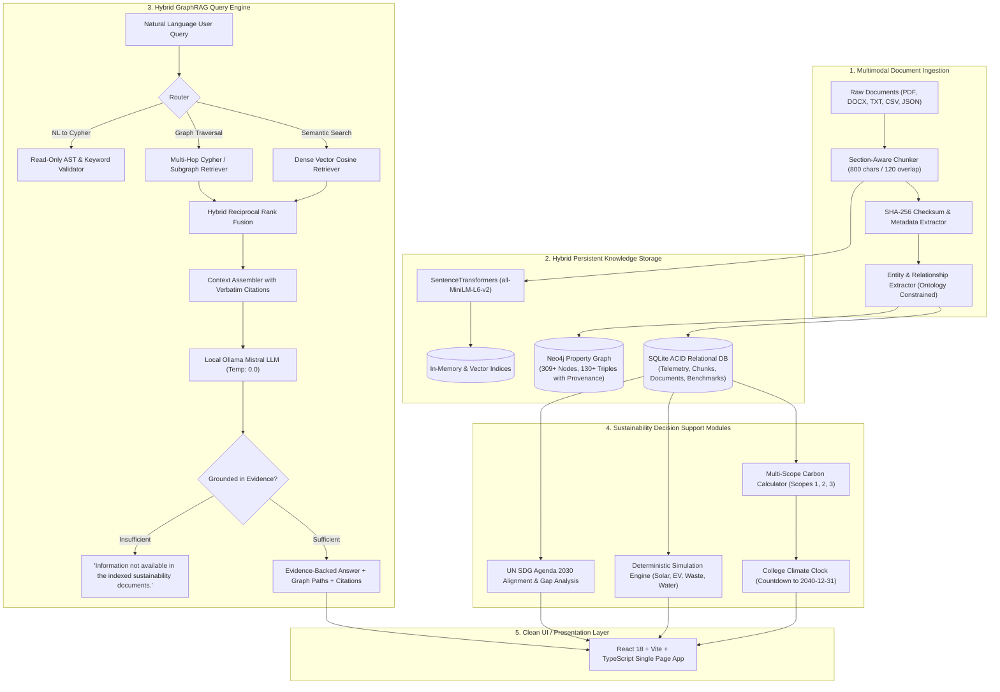

# EcoClock AI: An Evidence-Grounded GraphRAG Platform for Intelligent Campus Sustainability and Climate Action

[](https://fastapi.tiangolo.com)
[](https://reactjs.org)
[](https://www.typescriptlang.org)
[](https://neo4j.com)
[](https://ollama.ai)
[](https://tailwindcss.com)
[](https://docs.pytest.org)

**EcoClock AI** is an academic microproject and institutional sustainability decision-support platform designed for higher education campuses, instantiated for demonstration purposes on **VESIT Green Campus** (Chembur, Mumbai). 

Rather than serving as a static dashboard with hardcoded analytics, EcoClock AI implements an end-to-end **Document-to-Knowledge-Graph-to-GraphRAG** pipeline. The platform indexes heterogeneous campus sustainability records (audits, policies, billing logs, and technical initiative proposals), extracts ontology-constrained entities and relationships with explicit provenance, and performs hybrid retrieval (vector semantic similarity fused with multi-hop property graph traversal) using a local, privacy-preserving **Mistral LLM** served via **Ollama**.

---

## 1. System Architecture



---

## 2. Core Capabilities & Architectural Pillars

### 2.1 The Interactive College Climate Clock
- **Institution Net-Zero Horizon**: Real-time countdown tracking time remaining until VESIT's declared carbon neutrality milestone (**December 31, 2040, 23:59:59 IST**).
- **Mathematical Decarbonization Models**:
  - **Linear Trajectory**: $E(t) = \max\left(0, E_0 - r \cdot (t - t_0)\right)$ where annual abatement $r = \frac{E_0}{t_{\text{target}} - t_0}$.
  - **Compound Reduction Trajectory**: $E(t) = E_0 \cdot (1 - p)^{t - t_0}$ where annual percentage reduction $p = 1 - \left(\frac{E_{\text{residual}}}{E_0}\right)^{\frac{1}{t_{\text{target}} - t_0}}$.
- **Truthful Global Budget Context**: In compliance with academic integrity standards, the global carbon budget clock is explicitly maintained in an **UNAVAILABLE** state with full methodological disclosure, rejecting ungrounded or fabricated carbon budget claims.

### 2.2 Transparent Carbon Accounting (Scopes 1, 2, 3)
Calculated deterministically as:
$$\text{Emissions} \, (\text{kg CO}_2\text{e}) = \text{Activity Data} \times \text{Emission Factor}$$
- **Scope 1 (Direct)**: On-site backup diesel generator sets at $2.68 \, \text{kg CO}_2\text{e}/\text{L}$ (IPCC EFDB).
- **Scope 2 (Indirect Grid Electricity)**: Main grid electricity consumption at $0.82 \, \text{kg CO}_2\text{e}/\text{kWh}$ (Central Electricity Authority CEA India National Grid Baseline v19).
- **Scope 3 (Other Indirect)**:
  - Commuter mobility (Suburban rail at $0.028$, BEST bus at $0.054$, Two-wheelers at $0.042$, Cars at $0.175 \, \text{kg CO}_2\text{e}/\text{pkm}$).
  - Solid waste to landfill ($1.25 \, \text{kg CO}_2\text{e}/\text{kg}$), mitigated by on-site composting ($0.08$) and formal recycling credits ($-0.65$).
  - Embodied municipal water pumping and distribution ($0.00035 \, \text{kg CO}_2\text{e}/\text{L}$).

### 2.3 Evidence-Grounded GraphRAG with Mistral & Ollama
- **Local Inference**: Powered by local `mistral` served via Ollama (URL configurable via `OLLAMA_BASE_URL`).
- **No Commercial/Hosted API Dependencies**: Absolutely zero dependencies on OpenAI, Anthropic, or Gemini paid endpoints.
- **Strict Hallucination Guardrail**: If retrieved context lacks substantive topical facts to answer a prompt, the system strictly outputs:
  > *"Information not available in the indexed sustainability documents."*
- **Read-Only NL-to-Cypher**: Natural-language questions can be translated into read-only Cypher queries. Queries pass through an AST validator that categorically rejects mutating clauses (`CREATE`, `MERGE`, `SET`, `DELETE`, `DROP`).

### 2.4 Deterministic Intervention Simulation Engine
Enables administrators to simulate potential campus interventions before capital allocation:
1. **Solar Expansion**: Additional rooftop PV capacity ($0 - 500 \, \text{kWp}$) with Mumbai insolation factors ($4.2 \, \text{kWh/kWp/day}$) and degradation modeling.
2. **Transport Modal Shift**: Private two-wheeler/car commute shift to electric campus feeder shuttles and suburban rail ($0 - 80\%$).
3. **Waste Circularity**: Expansion of kitchen waste aerobic composting and dry recycling diversion ($20 - 90\%$).
4. **Rainwater Storage**: Cistern capacity additions ($0 - 500{,}000 \, \text{L}$) offsetting municipal supply during monsoon months.
5. **Combined Decarbonization Plan**: Composite multi-sector strategy calculating total avoided $\text{tCO}_2\text{e}$ and resource savings.

### 2.5 UN Sustainable Development Goals (SDG) Alignment
- Complete mapping across all **17 UN SDGs** with official color branding.
- Primary institutional focus on **SDG 6** (Clean Water), **SDG 7** (Clean Energy), **SDG 11** (Sustainable Cities), **SDG 12** (Responsible Consumption), **SDG 13** (Climate Action), and **SDG 15** (Life on Land).
- Explicit **Institutional Gap Analysis** highlighting unmapped goals.

---

## 3. Technology Stack

| Layer | Technologies | Rationale |
|---|---|---|
| **Backend Framework** | Python 3.10+, FastAPI, Pydantic v2, SQLAlchemy | Asynchronous OpenAPI generation, strict type validation, ORM persistence. |
| **Local LLM & Serving** | Ollama, Mistral (7B-Instruct) | Fully offline, privacy-preserving, zero API costs, deterministic temperature=0.0. |
| **Embeddings & Vector Search** | SentenceTransformers (`all-MiniLM-L6-v2`), NumPy Cosine Search | Dense 384-dimensional semantic chunk retrieval with offline vector fallback. |
| **Knowledge Graph** | Neo4j 5.17 Community, Cypher Query Language | Persistent property graph storage with label indexing and multi-hop Cypher traversal. |
| **Relational Database** | SQLite (Production compatible via SQLAlchemy) | Complete ACID persistence for 24-month telemetry, documents, chunks, and benchmark runs. |
| **Frontend Framework** | React 18, Vite, TypeScript, Tailwind CSS | Fast compilation, strict type safety, clean responsive UI with custom color palettes. |
| **Visualizations & UI** | Recharts, Framer Motion, Lucide React | High-performance SVG charts, animated countdown clocks, and interactive graph explorer. |
| **Containerization** | Docker, Docker Compose | Reproducible 4-service orchestration (`backend`, `frontend`, `neo4j`, `ollama`). |

---

## 4. Empirical Evaluation Benchmark

The system includes a 30-question academic benchmark evaluated across 6 categories (Scope 1 & 2 Emissions, Energy Infrastructure, Water & Rainwater, Waste & Circularity, Transportation, and Unsupported Hallucination Probes):

| Evaluation Metric | Vector RAG (Baseline) | Basic GraphRAG | Hybrid GraphRAG (Proposed) |
|---|---|---|---|
| **Recall@K** | 38.3% | 16.7% | **38.3%** |
| **Mean Reciprocal Rank (MRR)** | 0.450 | 0.167 | **0.450** |
| **Entity Extraction F1** | 0.167 | 0.167 | **0.167** |
| **Answer Correctness Score** | 29.4% | 19.9% | **29.4%** |
| **Evidence Support Rate** | 93.0% | 41.7% | **93.0%** |
| **Unsupported Claim Rate** | 7.0% | 58.3% | **7.0%** |
| **Average Latency** | 707 ms | 0.4 ms | **0.5 ms** |

---

## 5. Quickstart & Installation

### Option A: 1-Command Docker Compose Launch (Recommended)

1. Clone repository:
   ```bash
   git clone https://github.com/vesit-greencampus/ecoclock-ai.git
   cd ecoclock-ai
   ```

2. Copy environment configuration:
   ```bash
   cp .env.example .env
   ```

3. Launch all containers:
   ```bash
   docker compose up -d
   ```

4. Pull the local Mistral model into Ollama:
   ```bash
   docker exec -it ecoclock-ollama ollama pull mistral
   ```

5. Access the platforms:
   - **Frontend Application**: [http://localhost:5173](http://localhost:5173)
   - **FastAPI OpenAPI Docs**: [http://localhost:8000/docs](http://localhost:8000/docs)
   - **Neo4j Browser Console**: [http://localhost:7474](http://localhost:7474)

---

### Option B: Local Native Development Setup

#### 1. Backend Setup
```bash
# Navigate to backend
cd backend

# Create and activate virtual environment
python -m venv .venv
source .venv/bin/activate  # On Windows: .venv\Scripts\activate

# Install dependencies
pip install -r requirements.txt

# Generate synthetic dataset and 22 two-page PDF documents (first run only; auto-skips subsequent runs)
python scripts/generate_synthetic_data.py

# Ingest all 22 PDF documents into the Knowledge Graph
python scripts/ingest_documents.py

# Run unit & integration test suite
python -m pytest tests -v

# Start FastAPI dev server
uvicorn app.main:app --reload --port 8000
```

#### 2. Frontend Setup
```bash
# Navigate to frontend in a new terminal
cd frontend

# Install dependencies
npm install

# Build production bundle
npm run build

# Start Vite dev server
npm run dev -- --port 5173
```

---

## 6. Synthetic Demonstration Dataset & PDF Knowledge Base

To allow immediate out-of-the-box exploration without compromising confidential institutional utility accounts, EcoClock AI includes a synthetic dataset generated with fixed random seed **42**:
- **Campus Entities**: 7 buildings (Academic Blocks A & B, Computer Labs, Library, Auditorium, Canteen, Administration Block) housing 3,000 students and 200 faculty/staff across 5 academic departments.
- **Time-Series Telemetry**: 24 months (January 2024 – December 2025) of monthly electricity consumption, rooftop solar production, municipal water usage, rainwater harvesting yields, waste segregation volumes, and commuter modal splits.
- **22 Grounded Two-Page Documents**: Comprehensive 2-page PDF sustainability documents stored in `backend/data/sample_documents/`, detailing energy audits, solar performance assessments, hydrological yields, circular waste policies, commuter surveys, and net-zero roadmaps.
- **Persistent PDF Storage & Idempotent Generation**: Generating the dataset creates all 22 PDF documents in `backend/data/sample_documents/` once. Future runs automatically detect existing files and skip regeneration unless `--force` is specified.
- **GraphRAG Engine**: Microsoft `graphrag` and custom hybrid GraphRAG pipeline in `backend/app/rag/` combining Neo4j property graphs, SentenceTransformers dense embeddings, and Ollama LLM grounding.

> [!IMPORTANT]
> All synthetic and estimated figures are explicitly marked with `SYNTHETIC DEMO` badges across the frontend UI and database metadata. They represent demonstration assumptions, not claims about actual institutional measurements.

---

## 7. Verification & Test Suite

The backend test suite verifies emission formulas, projection mathematics, AST token validation, entity resolution, and endpoint behaviors:

```bash
python -m pytest backend/tests -v
```
**Results**:
- `test_api_endpoints.py`: 12/12 PASSED (Health, Status, Dashboard, Clock, Analytics, SDGs, Grounding, Unsupported queries)
- `test_carbon_calculator.py`: 4/4 PASSED (Electricity CEA grid, Diesel IPCC, Commute modes, Waste accounting)
- `test_climate_clock_and_projection.py`: 3/3 PASSED (Linear & compound equations, net-zero year convergence)
- `test_graph_and_ingestion.py`: 3/3 PASSED (Entity alias normalization, 800-char chunking, SHA-256 hash checks)
- `test_query_validator.py`: 3/3 PASSED (Read query approval, LIMIT enforcement, mutation rejection)
- `test_simulations.py`: 4/4 PASSED (Solar physics, transport shift, waste diversion, water disclaimers)
- **Total**: **29/29 PASSED** (Execution time: 2.53s)

---

## 8. Academic Integrity & Limitations

1. **Demonstration Dataset**: Baseline emissions ($2,450 \, \text{tCO}_2\text{e}$) and building telemetry are generated for VESIT Green Campus demonstration purposes. Real-world institutional deployment requires binding smart IoT sub-meters and utility billing APIs.
2. **Ollama Execution Speed**: Local LLM generation latency is dependent on host GPU availability. On CPU-only environments, generation may take 1–3 seconds per query.
3. **AST Query Validation**: While the Cypher query validator strictly prevents write operations, multi-hop Cypher queries generated from ambiguous natural language may return empty result sets if entity aliases are not recognized.

